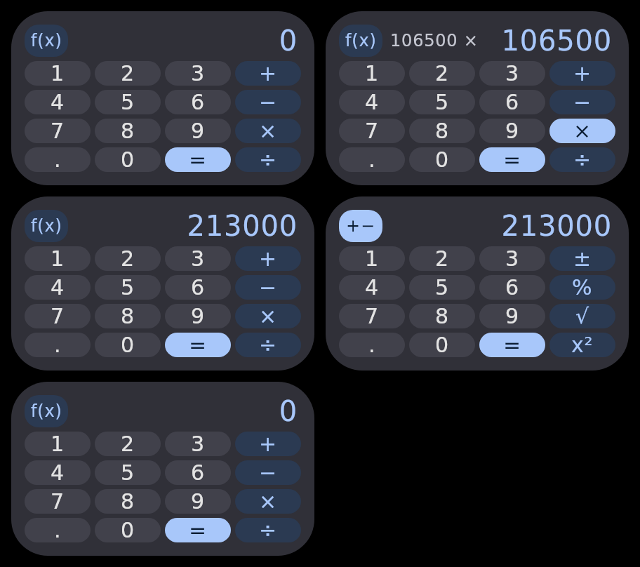

# Calculator widget demo

A local, interactive build of the UI builder design
[`cranky-bandit`](https://ui.coo.ee/ui-builder/remote-m3/cranky-bandit): a calculator in the
Glance Wear **large** widget container (216×124dp), as Remote Compose, with real calculator logic
behind it. The logic has **two backends** behind the same layout.

```bash
./gradlew -PcalculatorDemo=true :calculator-demo:run
```

The window shows both backends side by side.



It is opt-in (`-PcalculatorDemo=true` in `settings.gradle.kts`), so nothing in the catalog, its
committed records or CI builds it.

## Files

| File | What it is |
| --- | --- |
| `CalculatorLayout.kt` | The widget as `@RemoteComposable` content. It reads every value and action from `CalculatorBindings`, so it doesn't know which backend runs it. |
| `HostBackend.kt` | Backend 1, **host actions**: `CalculatorSession` and `rememberHostBindings`. |
| `DocumentBackend.kt` | Backend 2, **document expressions**: `rememberDocumentBindings`. |
| `Calculator.kt` | The Kotlin engine that backend 1 runs: an immutable, immediate-execution calculator (`2 + 3 ×` shows 5; `=` again repeats). |
| `Main.kt` | A Compose Desktop window that plays each backend in the container's frame, through `RcEmbeddedPlayer`, the live player the remote-m3 UI builder's Browser Preview uses. |

## Backend 1: host actions

The document only draws, and the app process does the work. This is the shape of a Glance Wear
widget whose app keeps the state. The two sides talk by **name**, through rc-players'
`RcHostBridge`:

- **Values.** The display, the pending expression, the operator labels and the highlight colours
  are named values (`display`, `op-add-label`, …). A press changes them without a new document, so
  the player keeps its state.
- **Actions.** Every key is a named host action (`key-7`, `op-multiply`, `equals`, `more`), handled
  by `CalculatorSession`.
- **Swipe.** The display's touch-down and touch-up are host actions carrying the player's touch x.
  The host clears when the two are at least 30% of the widget's width apart.

## Backend 2: document expressions

The document calculates by itself. It fires no host action, and a recorded document would work on
any player while its app sleeps. The UI test checks this: the player raises no host action at all
through the whole scenario.

- **State.** Ten remote floats: entry, decimal places typed, digits typed, accumulator, pending
  operator, a fresh-number flag, an operand-given flag, the repeat operator and operand, and an
  error flag. Two more hold the `f(x)` set and where a swipe started.
- **Keys.** Each key is a list of value-change actions. Their new values are expressions the player
  evaluates at the press, with `select` standing in for `if`. An action list is fixed when the
  document is recorded, so a key that does different things in different states assigns
  `condition.select(a, b)` to every register. An operator key in the `f(x)` set does this between
  its binary step and its unary one.
- **Display.** Formatted in the document. A result has up to 6 decimal places with trailing zeros
  dropped. A number being typed shows exactly the decimals typed, so `2.50` keeps its zero.
- **Swipe.** Touch-down stores the touch x. Touch-up resets every register if the touch moved far
  enough, and otherwise writes each register back unchanged.

What a document can hold sets its limits:

- **32-bit floats.** A typed number is at most 7 digits, results show 6 decimals, and anything past
  ±999,999,999 is `Error`. Backend 1 computes in doubles and shows 9 digits.

### Two things the document had to work around

- **Every key computes into a second bank, then commits.** One press assigns several registers from
  the *old* values of several registers: an operator sets both the accumulator and the entry from
  both of them. The player runs a value-change list in order, and how a later write sees an earlier
  one depends on how the expression was recorded:
  - A mutable float read directly gives the new value.
  - A shared sub-expression recorded as its own variable still holds its value from the last frame.

  So phase one writes `next` registers, reading only the committed ones, and phase two copies
  `next` into `current`. Neither phase reads anything it has already written.
- **Mutable floats with the same initial value are one variable.** The common document writer
  (`RemoteDocumentWriter.floatExpression`) caches float expressions by content, and a mutable float
  is declared as one. So every `rememberMutableRemoteFloat(0f)` in a document shares an id.
  `rememberRegister` declares each register with an expression unique to it that still evaluates to
  its initial value. `MutableFloatIdentityTest` pins the bug and fails once the writer is fixed;
  then delete the test and the workaround.

## Layout: from the tile to the widget

The design started from a round calculator tile, with glyphs floating in a 5×4 grid. In a
200×108dp content slot, that left a third of the space empty and gave no visible tap targets.

- **Four columns, not five.** The digit block is 3×4 (`.` `0` `=` on the last row). Every operator
  shares the right-hand column, `−` included, so each key is a quarter of the width (~50dp) rather
  than a fifth.
- **Pills.** Each key is a tonal pill that fills its cell, so the whole slot is a tap target. `=`
  is filled, and the pending operator lights up until the next one.
- **The display row does three jobs.** The `f(x)` key, the pending operation (`106500 ×`) in
  small type, and the number, right-aligned.
- **No `C` key.** A swipe across the display clears, which frees a cell for `=`.
- **`f(x)` swaps the operator column** to `±` `%` `√` `x²` for one step, then back.
- **No `spacedBy`.** Under this player, weighted children with `spacedBy` overflow the row by the
  total spacing, so each key insets its own pill by half a gap instead.

Known limits:

- The container is the Pixel Watch squircle host (8dp padding, 26dp corners). The round host's
  stadium has not been checked.
- On a real watch, a horizontal swipe may be taken by the launcher's carousel before the widget
  sees it.

## Tests

```bash
./gradlew -PcalculatorDemo=true :calculator-demo:test
```

- `CalculatorTest` covers the Kotlin engine.
- `CalculatorWidgetUiTest` runs one scenario against **both** backends, through the real player.
  - It drives them with pointer input: key taps at their positions, swipes, and a tap on the
    display that must not clear.
  - It reads the display from the text the player laid out, and expects the same results from both.
  - Its captures land in `build/screenshots/<backend>/`.
- `MutableFloatIdentityTest` pins the writer behaviour described above.
